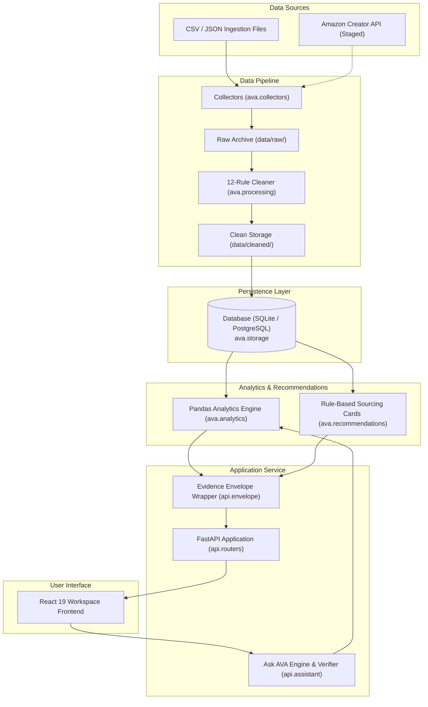
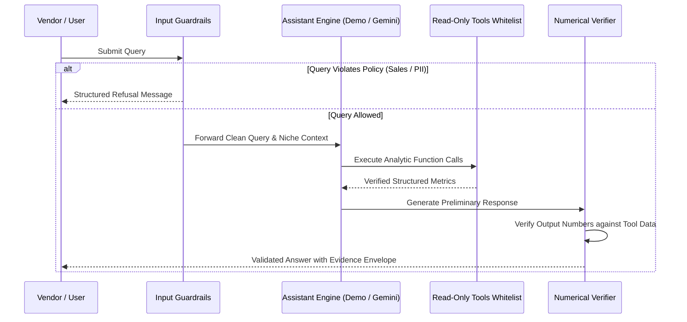

# Amazon Vendor Assist (AVA)

> Sell smarter. Sell what people want.

Amazon Vendor Assist (AVA) is an open, compliance-first vendor intelligence and merchandising analytics platform designed for small and regional apparel sellers and manufacturers in India.

The platform addresses the information asymmetry that regional apparel manufacturers face when selling through e-commerce marketplaces. Sellers frequently make sourcing, fabric, sizing, and pricing decisions without structured visibility into market demand, resulting in dead stock, return penalties, and mispriced listings. AVA processes catalog listing observations, pricing distributions, and customer feedback to produce structured sourcing blueprints, price corridor recommendations, and category benchmarks.

The current pilot implementation focuses on a high-velocity ethnic wear category: **Women's Kurtas & Kurtis**.

---

## Table of Contents

- [Key Features](#key-features)
- [System Architecture](#system-architecture)
- [Repository Structure](#repository-structure)
- [Technology Stack](#technology-stack)
- [Data Pipeline](#data-pipeline)
- [Analytics and Recommendation Methodology](#analytics-and-recommendation-methodology)
- [Ask AVA Assistant](#ask-ava-assistant)
- [Getting Started](#getting-started)
- [Running Tests](#running-tests)
- [API Documentation](#api-documentation)
- [Data Sources, Compliance and Limitations](#data-sources-compliance-and-limitations)
- [Roadmap](#roadmap)
- [Contributing and License](#contributing-and-license)

---

## Key Features

### Implemented Capabilities

- **Catalog Ingestion and Normalization:** A 12-step cleaning pipeline parses Indian Rupee (INR) prices, validates MRP invariants, normalizes garment sizes to a standard ladder (`XS` through `6XL`), and strips promotional prefixes from brand names.
- **Market and Pricing Analytics:** Pure Pandas analytical engine computes median price points, interquartile ranges, 6-tier price distribution histograms, and brand share concentration without database dialect dependencies.
- **Niche Definition and Filtering:** Multi-attribute filtering across price corridors, fabric compositions, patterns, and sizing ladders, complete with real-time sample size previews and small-sample warnings (`n < 5`).
- **Voice of Customer (VoC) Diagnostics:** Review sentiment evaluation, rating distributions, and qualitative issue identification across critical apparel dimensions (sizing fit, fabric shrinkage, and stitching durability).
- **Rule-Based Sourcing Recommendations:** Deterministic recommendation cards that identify pricing sweet spots, fabric specifications, and extended size coverage opportunities with explicit evidence thresholds and confidence ratings.
- **Product Benchmarking:** Detailed diagnostic view comparing individual listing attributes and price points directly against niche medians and benchmark listings.
- **Ask AVA Assistant:** Grounded analytics copilot utilizing read-only analytical tools, strict scope guardrails (rejecting queries for proprietary competitor sales or private customer information), and a post-generation numerical verifier.
- **Vendor Onboarding Flow:** Vendor registration and multi-step profile setup with simulated OTP verification and browser-persistent profile storage for demonstration workflows.

### Planned Capabilities (Staged / Not Yet Implemented)

- Live Amazon Selling Partner API (SP-API) production ingestion.
- Catalog expansion across remaining apparel categories (Sarees, Men's Ethnic Wear, Western Tops).
- PDF/Excel manufacturing specification export for textile job workers.
- Multi-user authentication backed by an identity provider.

---

## System Architecture

The AVA platform is organized into three distinct tiers: a single-page React frontend, a FastAPI service layer, and an isolated core Python library that handles analytics, ingestion, and persistence.



### Component Responsibilities

1. **Frontend (`frontend/`):** A React 19 single-page application structured into functional workspaces. All analytical figures render directly from API responses; the frontend performs no client-side metric derivation.
2. **API Layer (`api/`):** FastAPI service exposing RESTful `/api/v1/` endpoints. All analytical responses are wrapped in an Evidence Envelope containing sample size, observation timestamp, and standing disclaimers.
3. **Core Analytics Library (`ava/`):** Independent Python package implementing business rules, catalog cleaning, Pandas aggregations, and abstract database access.
4. **Storage Layer (`ava.storage`):** Abstract repository pattern implemented with SQLAlchemy, supporting default SQLite storage for local evaluation and PostgreSQL for staging.
5. **AI Assistant (`api/assistant/`):** Query grounding engine featuring an input guardrail filter, 6 read-only analysis tools, an offline deterministic fallback engine, optional Google Gemini integration, and a post-generation numerical verification pass.

---

## Repository Structure

```text
.
├── api/                        # FastAPI application service
│   ├── assistant/              # Ask AVA tools, prompt, guardrails, and verifier
│   ├── routers/                # Endpoint handlers (/api/v1/...)
│   ├── schemas/                # Pydantic request and response schemas
│   ├── envelope.py             # Evidence envelope construction
│   └── main.py                 # FastAPI application initialization
├── ava/                        # Core domain and analytics library
│   ├── analytics/              # Pandas market aggregations and opportunity scoring
│   ├── collectors/             # File and source collection orchestrators
│   ├── processing/             # 12-rule parser, validator, and deduplicator
│   ├── recommendations/        # Deterministic sourcing rule engine
│   ├── sources/                # CSV, JSON, and external source adapters
│   └── storage/                # SQLAlchemy models, repositories, and migrations
├── data/
│   ├── cleaned/                # Normalized CSV/JSON artifacts and cleaning reports
│   ├── raw/                    # Immutable, timestamped ingestion snapshots
│   ├── reports/                # Generated Markdown and JSON market summaries
│   └── sample/                 # Synthetic pilot datasets (SYN-KUR-001..032)
├── docs/                       # Specifications, contracts, and architecture audits
│   ├── api-contract.md         # REST endpoint catalog and envelope schema
│   ├── data-dictionary.md      # 18 product and 8 review canonical field definitions
│   ├── limitations.md          # Methodological and sampling limitations
│   └── openapi.json            # Machine-readable OpenAPI 3.1 specification
├── frontend/                   # React 19 + TypeScript + Vite user interface
│   ├── fixtures/               # Offline contract fixtures for local development
│   ├── src/                    # Application source code
│   │   ├── components/         # Shared UI components and error boundaries
│   │   ├── services/           # Typed API service client
│   │   ├── types/              # Domain TypeScript interfaces
│   │   └── workspaces/         # 10 dedicated functional workspace views
│   └── package.json
├── legacy/                     # Quarantined historical analysis
│   └── customer-shopping/      # Exploratory retail shopping transaction analysis
├── tests/                      # Automated test suite (44 tests)
│   ├── api/                    # Integration tests for FastAPI endpoints
│   ├── assistant/              # Assistant guardrail and verifier evaluations
│   ├── contract/               # OpenAPI contract and fixture validations
│   └── core/                   # Parsing, validation, analytics, and storage tests
├── docker-compose.yml          # Optional local PostgreSQL service
├── requirements.txt            # Python dependencies
└── run.py                      # Master command-line interface
```

> **Note on Legacy Code:** Exploratory transaction files from earlier customer shopping research are isolated in `legacy/customer-shopping/`. They have no runtime dependencies or imports within the AVA platform.

---

## Technology Stack

| Technology | Purpose | Layer |
|---|---|---|
| **Python 3.12+** | Core runtime environment | Backend / CLI |
| **FastAPI** | High-performance asynchronous REST API | Service Layer |
| **Pydantic v2** | Schema declaration and contract validation | API / Domain |
| **Pandas** | In-memory market analysis and price aggregations | Analytics |
| **SQLAlchemy 2.0** | Object-relational mapping and repository abstraction | Persistence |
| **Alembic** | Database schema migration management | Persistence |
| **SQLite / PostgreSQL** | Relational data stores (SQLite default, PostgreSQL optional) | Persistence |
| **Uvicorn** | ASGI server implementation | Service Layer |
| **React 19** | Component-based UI framework | Frontend |
| **TypeScript 5.8** | Static type checking for client stability | Frontend |
| **Vite 6** | Frontend tooling and development server | Frontend |
| **Tailwind CSS 4** | Design token styling and responsive layout | Frontend |
| **Lucide React** | Standard interface icons | Frontend |
| **Pytest** | Automated unit, contract, and integration testing | Quality Assurance |

---

## Data Pipeline

The data pipeline processes catalog observations through a repeatable, unidirectional sequence:

```text
Source File / Adapter
       │
       ▼
Raw Ingestion Snapshots (data/raw/)
       │
       ▼
Validation, Parsing & Deduplication (ava.processing)
       │
       ▼
Clean Artifacts & Audit Logs (data/cleaned/)
       │
       ▼
Database Loader (ava.storage)
       │
       ▼
Pandas Analytics Aggregation (ava.analytics)
       │
       ▼
API Evidence Envelopes (api/)
       │
       ▼
Frontend Workspace Rendering (frontend/)
```

### 1. Ingestion Formats
The ingestion layer supports UTF-8 CSV with byte-order marks (BOM), line-delimited JSON (JSONL), and standard JSON arrays. Raw inputs are written into `data/raw/` with UTC ISO-8601 timestamps and source provenance tags.

### 2. Canonical Schemas
- **Products (18 fields):** `asin`, `product_name`, `category`, `brand`, `price`, `mrp`, `discount_pct`, `rating`, `review_count`, `colour`, `material`, `pattern`, `sizes`, `seller`, `availability`, `product_url`, `source`, `collected_at`.
- **Reviews (8 fields):** `review_id`, `asin`, `rating`, `title`, `body`, `verified_purchase`, `review_date`, `source`.

Detailed field types, nullable constraints, and allowable ranges are documented in the [Data Dictionary](docs/data-dictionary.md).

### 3. Cleaning and Validation Rules
- **Price Invariant:** Selling price must be greater than zero. Maximum Retail Price (`mrp`) must be greater than or equal to `price`. If `mrp < price`, the MRP is set to `null` and flagged in the cleaning report.
- **Size Normalization:** Garment size strings are mapped to canonical sequence order: `XS < S < M < L < XL < 2XL < 3XL < 4XL < 5XL < 6XL`.
- **ASIN Validation:** Must match standard marketplace alphanumeric formats or synthetic demo patterns (`SYN-KUR-xxx`).
- **Deduplication:** When duplicate ASINs appear, the record with the most recent `collected_at` timestamp is retained; ties break in favor of field completeness.
- **Audit Trails:** Rejected records are saved with failure reasons to `data/cleaned/products_rejected.csv`, and run statistics are output to `data/cleaned/cleaning_report.json`.

---

## Analytics and Recommendation Methodology

All market metrics are calculated in memory using Pandas to avoid SQL dialect discrepancies between development (SQLite) and staging (PostgreSQL) environments.

### 1. Market Medians and Distributions
- **Price Metric:** Uses the true median rather than the mean to prevent luxury outliers from skewing price guidance.
- **Price Bands:** Catalog listings are grouped into 6 standard price corridors:
  - `₹0 – ₹499` (Budget / Entry)
  - `₹500 – ₹999` (Core High-Velocity Volume)
  - `₹1,000 – ₹1,499` (Mid-Tier Premium)
  - `₹1,500 – ₹1,999` (Occasion Wear)
  - `₹2,000 – ₹2,999` (Designer Ethnic)
  - `₹3,000+` (Luxury / Festive)
- **Brand Concentration:** Measures the proportion of catalog listings controlled by the top 5 brands to evaluate competitive entrenchment.

### 2. Rule-Based Sourcing Cards
Recommendations are generated through deterministic heuristics rather than black-box machine learning models:
- **Price Sweet Spot:** Identifies the price band with the highest concentration of listings maintaining an average rating of $\ge 4.0\star$.
- **Fabric Opportunity:** Evaluates material counts and customer review conversion to highlight underserved textiles (e.g., 60s combed cotton).
- **Extended Size Coverage:** Detects categories where listings offering `3XL` or larger fall below minimum market availability thresholds.
- **Guardrails:** Recommendations require a minimum sample size ($n \ge 5$). Confidence ratings are capped at **Low** or **Moderate** (never "High") to reflect observational sampling constraints. Recommendations are framed as *worth investigating*, not as guaranteed commercial outcomes.

---

## Ask AVA Assistant

Ask AVA provides conversational analysis over the current category and active niche filters.



### Architecture and Safeguards

1. **Input Guardrails:** Regex and pattern filters inspect incoming prompts. Queries requesting proprietary competitor sales figures, revenue estimations, or customer personally identifiable information (PII) are immediately rejected with standardized explanatory notices.
2. **Read-Only Tool Whitelist:** The assistant only accesses data through 6 deterministic query functions:
   - `get_market_summary`: Retrieves sample size, price quartiles, and brand share.
   - `get_price_bands`: Retrieves volume counts and average ratings across the 6 price corridors.
   - `get_brand_and_attribute_counts`: Counts distributions for colours, fabrics, patterns, and sizes.
   - `get_opportunities`: Retrieves rule-based preliminary market opportunity cards.
   - `get_review_summary`: Retrieves review totals and star rating distributions.
   - `get_listing_details`: Retrieves individual product specification records.
3. **Dual Execution Modes:**
   - **Demo Engine (Default):** Deterministic pattern matcher that answers standard analytical questions offline with zero API keys required.
   - **Google Gemini Mode:** Connects to the Gemini API (`gemini-1.5-flash` / `gemini-2.5-flash`) using tool function calling with prompt-injected niche context.
4. **Numerical Verifier:** Scans generated response text for numerical figures (currencies, percentages, counts, ratings). If the response introduces metrics unsupported by tool outputs (within rounding tolerances), the verifier flags the response.

> **Note on LLM Behavior:** While numerical verification significantly restricts invented statistics, it cannot prevent all potential contextual or qualitative misinterpretations by language models.

---

## Getting Started

### Prerequisites

- **Python:** 3.12 or newer
- **Node.js:** 18.0 or newer
- **Package Manager:** npm 9.0 or newer
- **Git**

### 1. Clone the Repository

```bash
git clone https://github.com/Anwesh0407/amazon-vendor-assist.git
cd amazon-vendor-assist
```

### 2. Backend Environment Setup

Create and activate a virtual environment, then install dependencies:

```bash
python3 -m venv backend/.venv
source backend/.venv/bin/activate
pip install -r requirements.txt
```

### 3. Configure Environment Variables

Copy the template configuration file:

```bash
cp .env.example .env
```

Default settings operate completely offline with SQLite (`sqlite:///./ava.db`) and the deterministic demo assistant engine (`ASK_AVA_MODE=demo`). To enable live Gemini assistant queries, set `ASK_AVA_MODE=gemini` and supply a valid `GEMINI_API_KEY` in `.env`.

### 4. Execute the End-to-End Data Pipeline

Run the master CLI to ingest synthetic sample data, clean records, compute market summaries, and populate the database:

```bash
python run.py pipeline
```

### 5. Start the FastAPI Service

```bash
python run.py serve --port 8000
```

The API service will start on `http://localhost:8000`. You can verify operation at:
- Health check: `http://localhost:8000/health`
- Interactive API Documentation: `http://localhost:8000/docs`

### 6. Frontend Setup and Launch

In a separate terminal window:

```bash
cd frontend
npm install
npm run dev
```

Open `http://localhost:5173` in your browser to access the interface.

---

## Running Tests

The test suite covers data parsing, validation rules, analytics mathematics, API contracts, storage roundtrips, and assistant golden queries.

### Backend Automated Tests

Run the full Pytest test suite (44 tests):

```bash
backend/.venv/bin/pytest
```

```text
======================== 44 passed, 3 warnings in 2.81s ========================
```

### Frontend Type Checking and Build

Verify TypeScript compilation and production bundle creation:

```bash
cd frontend
npm run build
```

---

## API Documentation

FastAPI automatically generates interactive API documentation available when the server is running:

- **Swagger UI:** `http://localhost:8000/docs`
- **ReDoc:** `http://localhost:8000/redoc`
- **OpenAPI Schema:** Exported on startup to [docs/openapi.json](docs/openapi.json)

### Core Endpoint Groups

| Route Prefix | Description | Primary Response Entity |
|---|---|---|
| `/api/v1/meta` | System status, data mode, and environment flags | `MetaResponse` |
| `/api/v1/categories` | Catalog category listing and availability statuses | `List[CategoryResponse]` |
| `/api/v1/niches` | Niche CRUD, filtering rules, and count previews | `NicheResponse` |
| `/api/v1/products` | Paginated product queries, detail views, and similar items | `EvidenceEnvelope[ProductList]` |
| `/api/v1/analytics` | Price distributions, market summaries, and opportunity insights | `EvidenceEnvelope[MarketSummary]` |
| `/api/v1/reviews` | Review listings and Voice of Customer sentiment metrics | `EvidenceEnvelope[ReviewList]` |
| `/api/v1/recommendations` | Deterministic vendor sourcing blueprints and action cards | `EvidenceEnvelope[RecommendationList]` |
| `/api/v1/assistant` | Conversational query endpoint with function-grounded tools | `AskQuestionResponse` |

---

## Data Sources, Compliance and Limitations

### Data Sourcing and Marketplace Compliance

1. **Synthetic Demo Data:** The repository currently operates on 32 synthetic pilot products (`SYN-KUR-001` through `SYN-KUR-032`) and 10 synthetic customer reviews. Product URLs resolve to RFC 2606 test domains (`example.com`).
2. **Prohibition on Unauthorized Scraping:** Outbound HTTP requests to `amazon.in` and commercial marketplace domains are explicitly blocked via network-layer domain denylists in `ava/config.py`.
3. **Official Ingestion Paths:** Live marketplace data collection requires authorized Amazon Selling Partner API (SP-API) or Amazon Creator API credentials.

### Analytical and Methodological Limitations

- **Observational Proxy Only:** Customer review counts reflect relative listing age and cumulative customer engagement. They do **not** indicate actual product unit sales, inventory turnover, or vendor revenue.
- **Point-in-Time Public Catalog:** Metrics represent a static snapshot of public catalog listings and do not account for unlisted variations or seasonal rotation.
- **Self-Selected Review Bias:** Customer reviews originate from voluntary submissions and disproportionately represent polarizing customer experiences.
- **Unmeasured Variables:** AVA does not track private marketing expenditure, return rates, net advertising cost of sales (ACOS), or individual vendor profit margins.

For a full methodological breakdown, see [docs/limitations.md](docs/limitations.md).

---

## Roadmap

- [ ] **SP-API Integration:** Connect official Amazon Selling Partner API endpoints for authenticated vendor inventory and order diagnostics.
- [ ] **Category Expansion:** Release curated catalogs for upcoming pilot categories:
  - Sarees & Traditional Drapes
  - Fashion Jewellery & Accessories
  - Men's Kurtas & Ethnic Wear
  - Western Tops & Tunics
- [ ] **Manufacturing Export Pipeline:** One-click technical specification sheets (tech packs) formatted for regional textile jobbers.
- [ ] **Authentication Layer:** Implement secure multi-tenant vendor authentication and organization management to replace the current client-side demonstration flow.
- [ ] **Containerized Deployment:** Docker and Helm manifests for automated cloud deployment.

---

## Contributing and License

### Contributing

1. Fork the repository.
2. Create a feature branch: `git checkout -b feature/your-feature-name`.
3. Ensure backend tests pass: `pytest`.
4. Ensure the frontend builds cleanly: `npm run build`.
5. Submit a descriptive Pull Request.

### License

This repository does not currently include a public open-source license. All rights are reserved by the repository maintainers. An open-source license may be assigned in a future release.
